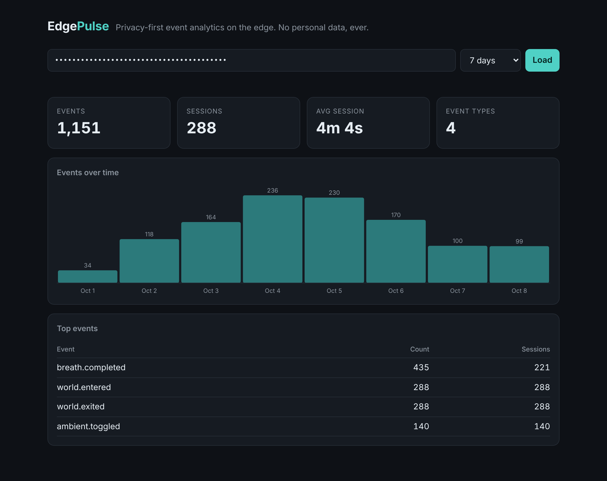
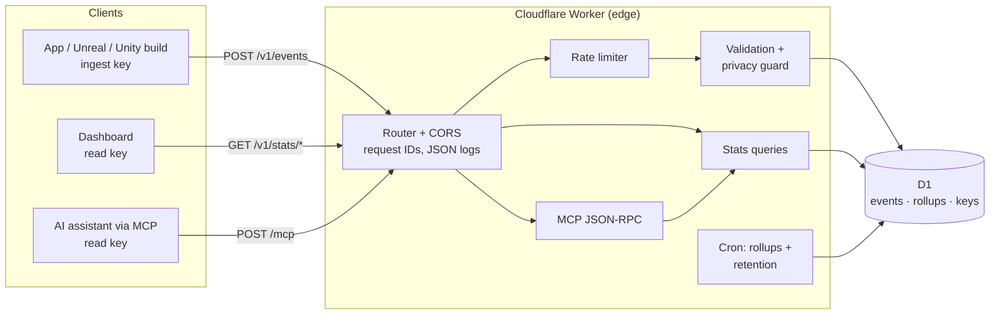

# EdgePulse

**Privacy-first event analytics on Cloudflare Workers + D1, with a built-in MCP server so AI agents can query it.**

[](https://github.com/SIDDARTHAREDDY8/edgepulse/actions/workflows/ci.yml)


EdgePulse collects product events from apps, games, and immersive experiences (a browser, a mobile app, an Unreal or Unity build) and answers questions about them, from a dashboard, a REST API, or an AI assistant over the Model Context Protocol.

It is built for products where **nobody should be tracked**: there are no user IDs, no IP addresses, and no user agents in the schema. A server-side privacy guard refuses personal data even when a client tries to send it.



---

## Why this exists

Most analytics tools start by identifying the user. That is the wrong default for healthcare staff tools, kiosks, kids' apps, and wellbeing products, where *being unobserved* is part of the product. EdgePulse answers the questions a team actually needs ("are people using it, how long do they stay, what do they do?") with **anonymous sessions only**, and runs at the edge so a client anywhere gets a fast acknowledgement.

## Features

| | |
|---|---|
| **Edge ingest** | `POST /v1/events` takes batches of up to 100 events and writes them in one D1 transaction. |
| **Idempotent by design** | `(project_id, event_id)` is the primary key. A client that times out and retries cannot double count. |
| **Partial success** | One bad event doesn't sink a batch. You get `202`, `207` (mixed), or `422` with a per-event reason. |
| **Privacy guard** | Refuses keys like `email`, `patient_id`, `ip`, and refuses *values* that look like emails, phone numbers, IPs, or SSNs under any key. |
| **Scoped API keys** | Write-only `ingest` keys are safe to ship inside a client build; `read` keys unlock stats and MCP. Only SHA-256 hashes are stored. |
| **Multi-project isolation** | Every query and index leads with `project_id`; tests prove one project can't see another's data. |
| **Stats API** | Summary (events, sessions, avg/max session length), top events, zero-filled hourly/daily series. |
| **MCP server** | `POST /mcp` speaks MCP (Streamable HTTP, stateless) with four read-only tools. Verified against the official MCP TypeScript SDK client. |
| **Cron maintenance** | A daily Cron Trigger builds per-day rollups (recomputed, so late events never double count) and enforces per-project retention. |
| **Rate limiting** | Exact, global fixed-window limiter in D1 with `Retry-After`. |
| **Built-in dashboard** | Zero-dependency page served by the Worker itself at `/`. |

## Architecture



The REST API and the MCP tools call **the same query functions** (`src/stats.ts`), so a dashboard and an AI agent can never disagree about a number.

```
src/
  index.ts        routing, entry points (fetch + scheduled), access logging
  validation.ts   event schema + privacy guard
  ingest.ts       batch validation and transactional, idempotent writes
  stats.ts        read-side queries shared by REST and MCP
  mcp.ts          Model Context Protocol server (JSON-RPC 2.0)
  auth.ts         hashed, scoped API keys; constant-time admin check
  ratelimit.ts    D1 fixed-window limiter
  maintenance.ts  cron rollups, retention purge, limiter cleanup
  dashboard.ts    self-contained dashboard page
migrations/       D1 schema (wrangler d1 migrations)
test/             56 tests running inside workerd against a real D1 database
```

## Quick start (local)

```bash
git clone https://github.com/SIDDARTHAREDDY8/edgepulse.git && cd edgepulse
npm install
echo "ADMIN_TOKEN=dev-admin-token" > .dev.vars
npm run db:migrate:local
npm run dev                          # http://localhost:8787
```

Create a project. The response contains the only copy of its two keys:

```bash
curl -s -X POST localhost:8787/v1/admin/projects \
  -H "authorization: Bearer dev-admin-token" -H "content-type: application/json" \
  -d '{"name":"My app","retention_days":90}'
```

Fill it with a week of realistic demo traffic, then open http://localhost:8787 and paste the read key:

```bash
node scripts/seed-demo.mjs http://localhost:8787 <ingest-key>
```

## Sending events

```bash
curl -X POST localhost:8787/v1/events \
  -H "authorization: Bearer <ingest-key>" -H "content-type: application/json" \
  -d '{
    "events": [{
      "event_id": "7f0c1c1e-3c55-4c55-9a8e-5d2b5b1f2a10",
      "name": "world.entered",
      "session_id": "sess_9f2c4ab01d7e",
      "ts": "2026-10-08T14:03:00Z",
      "props": { "world": "temple", "build": "1.4.2" }
    }]
  }'
```

| Field | Rules |
|---|---|
| `event_id` | Required. 8–64 chars `[A-Za-z0-9_-]`. A UUID is ideal; reuse it on retry. |
| `name` | Required. Lowercase, starts with a letter, `[a-z0-9_.:-]`, max 64. |
| `session_id` | Required. An **opaque random** token, 8–64 chars. Generate it per session; never derive it from a person. |
| `ts` | Optional. Epoch ms or ISO-8601. Must be within the last 7 days and no more than 5 minutes ahead. Defaults to receive time. |
| `props` | Optional. Flat object, ≤ 20 keys, snake_case keys, values are string (≤ 200 chars), number, or boolean. |

A mixed batch returns `207` with exactly what was refused and why:

```json
{
  "accepted": 99,
  "duplicates": 0,
  "rejected": [
    { "index": 42, "event_id": "…", "errors": ["props.note: value looks like a phone number and is not accepted"] }
  ]
}
```

## Querying

All read endpoints take `from` / `to` as epoch ms or ISO-8601 (default: last 7 days) and a `read` key.

| Endpoint | Returns |
|---|---|
| `GET /v1/stats/summary` | events, unique sessions, event types, avg/max session seconds |
| `GET /v1/stats/top-events?limit=10` | event names ranked by count, with unique sessions |
| `GET /v1/stats/timeseries?interval=hour\|day&name=…` | zero-filled buckets (max 1,000) |
| `GET /v1/stats/event-names` | every event name and when it was last seen |
| `GET /v1/stats/daily?from=YYYY-MM-DD&to=YYYY-MM-DD` | long-range history from rollups (survives raw-event retention) |
| `GET /health` | liveness + D1 round-trip latency |

## Asking an AI assistant (MCP)

EdgePulse is an MCP server at `/mcp`. Any MCP client can connect with a read key and ask plain-language questions such as *"How many sessions did we have this week, and is breathing-exercise usage going up?"*

| Tool | What it does |
|---|---|
| `list_event_names` | Discover what has been recorded |
| `get_summary` | Totals and session length for a range |
| `get_top_events` | Ranked event counts |
| `get_timeseries` | Hourly or daily series, optionally for one event |

Every tool is annotated `readOnlyHint: true`. Results come back both as text and as `structuredContent`. Bad arguments (an impossible range, an hourly series over a year) come back as in-band tool errors, so the model can read the message and correct itself.

Example client configuration (see [`examples/mcp-client.json`](examples/mcp-client.json)):

```json
{
  "mcpServers": {
    "edgepulse": {
      "url": "https://edgepulse.<your-subdomain>.workers.dev/mcp",
      "headers": { "Authorization": "Bearer ep_read_..." }
    }
  }
}
```

## Deploy to Cloudflare

```bash
npx wrangler login
npx wrangler d1 create edgepulse        # paste the database_id into wrangler.jsonc
npm run db:migrate:remote
npx wrangler secret put ADMIN_TOKEN     # use a long random value
npm run deploy
```

Then set `ALLOWED_ORIGINS` in `wrangler.jsonc` to the origins that will send events from a browser, and create your first project with the admin endpoint.

## Testing

```bash
npm test          # 56 tests inside workerd (the real Workers runtime) with a real local D1
npm run typecheck
```

The suite covers validation and the privacy guard, idempotent and partial ingest, tenant isolation, key scopes and revocation, rate limiting, CORS, every stats query against hand-computed fixtures, the MCP handshake, tool calls and JSON-RPC error codes, and cron rollups including late-arriving events.

## Design decisions

- **D1 over KV or Durable Objects.** The read side is aggregation (`GROUP BY`, `COUNT(DISTINCT)`). That is SQL's home turf, and D1 keeps every query a single round trip.
- **Idempotency at the storage layer.** A composite primary key with `ON CONFLICT DO NOTHING` is simpler and stronger than an idempotency cache: it cannot expire, and it is transactional.
- **Partial batch success.** Clients in the field (headsets, kiosks, flaky hospital Wi-Fi) should not lose 99 good events because of one bad one.
- **Privacy enforced on the server.** Client-side discipline is not a guarantee. The guard is conservative by design: a numeric string of 10+ digits is refused because it might be a phone number; send numbers as JSON numbers.
- **Rollups are recomputed, not incremented.** Each cron run rebuilds the last three complete days, so events that arrive late (up to 7 days is accepted) are counted exactly once.
- **Exact limiter, with a stated trade-off.** One D1 upsert per request gives a precise, global count. At very high volume, the Workers Rate Limiting binding is the drop-in replacement (approximate, per location, no round trip).
- **`CAST` in bucketing SQL.** D1 can bind JavaScript numbers as REAL, which silently turns `ts / size * size` into float division. The test suite caught this; the query casts explicitly.

## License

MIT © Siddartha Reddy Chinthala
